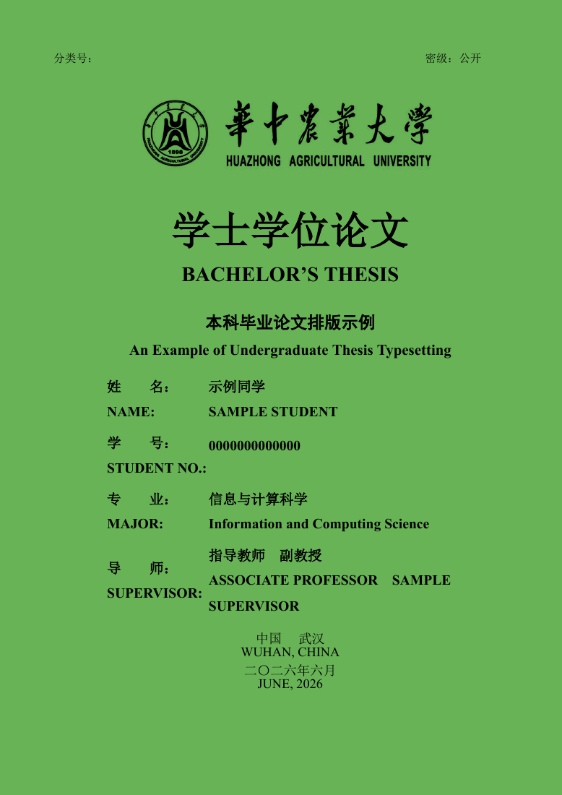
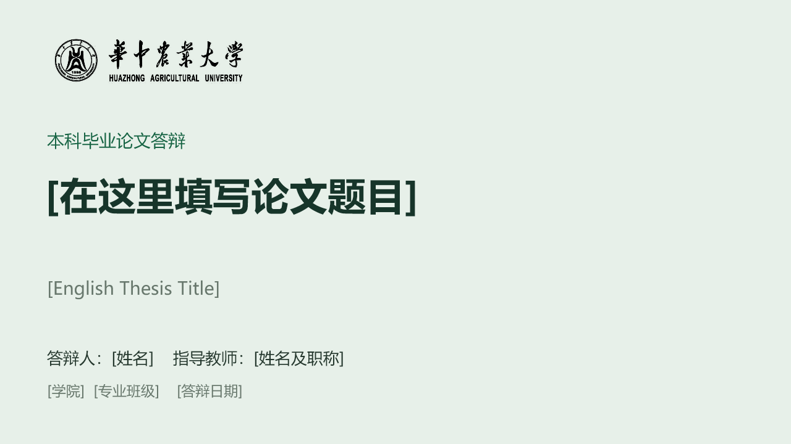
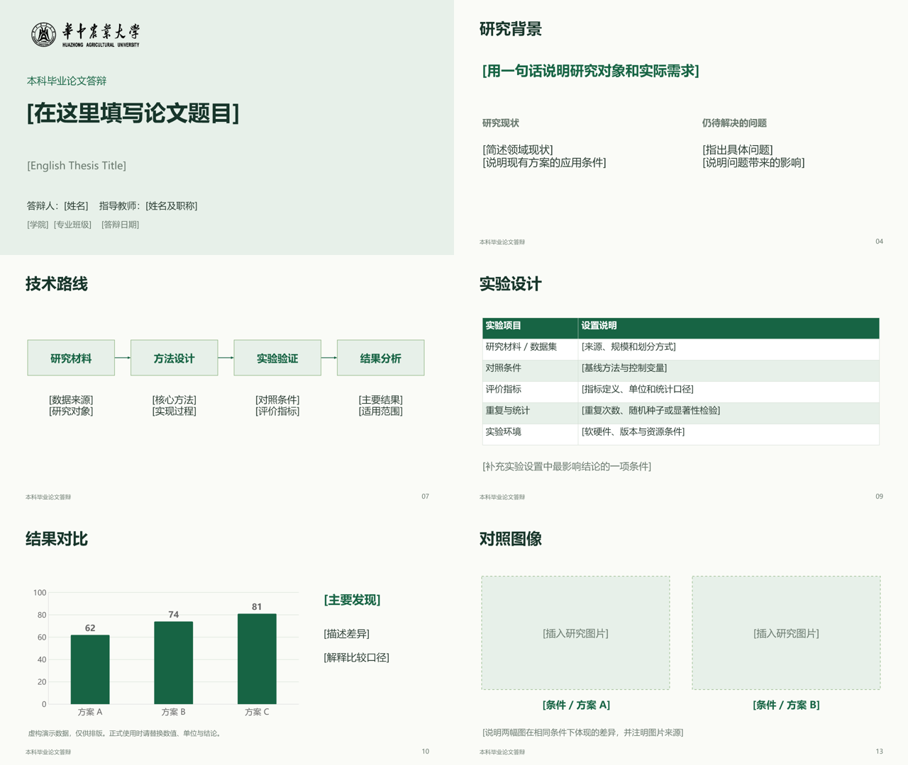
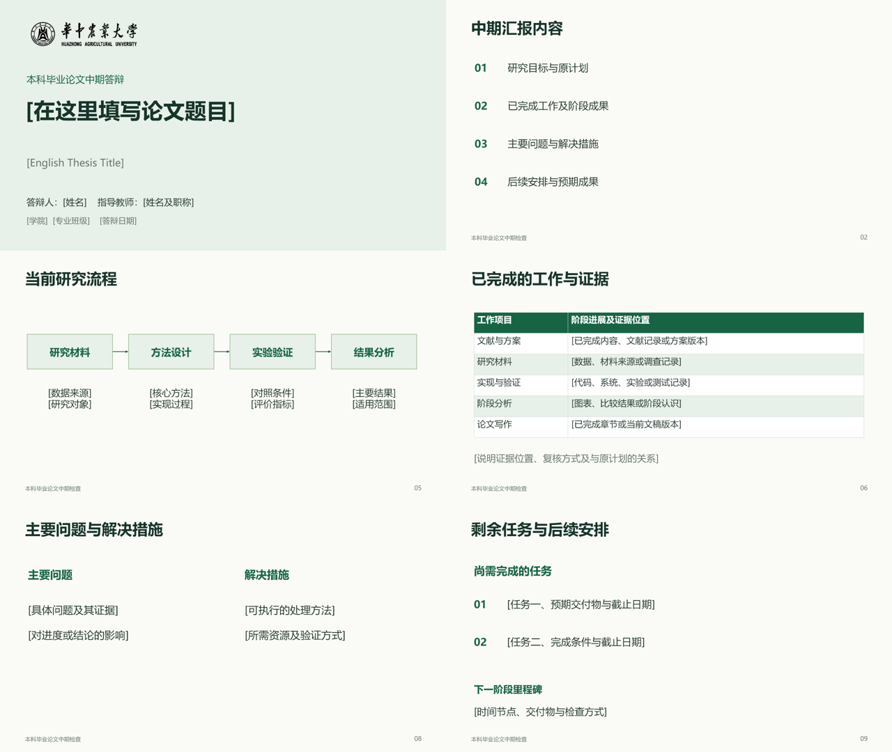

# 华中农业大学本科论文与答辩模板

可修改的 **LaTeX 论文模板 + 中期答辩 PPT + 毕业答辩 PPT**。整理者：陈江。

面向华中农业大学本科生，提供论文写作与答辩展示的可编辑示例。论文格式参考学校公开撰写规范，示例采用占位姓名、学号和演示数据，使用时可按专业与研究内容修改。具体提交要求以本届学院通知和导师意见为准。

## 从哪里开始

| 需求 | 入口 |
| --- | --- |
| 写论文 | [`latex/main.tex`](latex/main.tex)、[详细教程](latex/README.md) |
| 改题目和个人信息 | [`latex/config/metadata.tex`](latex/config/metadata.tex) |
| 查看论文排版 | [PDF 预览](docs/latex-preview.pdf) |
| 中期答辩 | [12 页 PPTX](ppt/HZAU-Midterm-Template.pptx)、[POTX](ppt/HZAU-Midterm-Template.potx) |
| 毕业答辩 | [18 页 PPTX](ppt/HZAU-Defense-Template.pptx)、[POTX](ppt/HZAU-Defense-Template.potx) |
| 使用 PPT | [PPT 教程](ppt/README.md) |
| 查看格式依据和兼容性 | [参考来源](docs/SOURCES.md)、[排版与兼容性说明](docs/THESIS_REVIEW.md) |

## 预览

<p>
  
  
</p>





## 写论文

安装包含中文支持的 TeX Live，确认 XeLaTeX、Biber、latexmk 可用。在 `latex/` 中运行：

```sh
latexmk -xelatex main.tex
```

生成 `main.pdf`。使用 **XeLaTeX + Biber**，只运行一次 XeLaTeX 无法完整更新目录和文献。

| 内容 | 修改位置 |
| --- | --- |
| 题目、姓名、学院、专业、班级、导师、日期 | `latex/config/metadata.tex` |
| 中英文摘要与关键词 | `latex/frontmatter/abstracts.tex` |
| 正文 | `latex/chapters/chapter1.tex` 至 `chapter5.tex` |
| 附录、代码、跨页表格 | `latex/chapters/appendix.tex` |
| 参考文献 | `latex/references.bib` |
| 致谢 | `latex/main.tex` 文末 |

模板演示封面、扉页、声明、自动目录、双语摘要、公式、双语图题、三线表、续表、伪代码和代码清单。示例数据全部为虚构排版数据。

默认使用 Windows 环境中的宋体、黑体和 Times New Roman。跨平台或 Overleaf 使用时，在 `main.tex` 的 `\documentclass[...]` 选项中加上 `portablefonts`，使用 Fandol 和 TeX Gyre Termes。切换字体后须检查分页。Overleaf 仅上传 **`latex/` 内的文件**，或使用专用 `Thesis-Overleaf.zip`，选择主文件 `main.tex`、编译器 XeLaTeX。两种字体模式均已通过本地编译验证，Overleaf 平台兼容性尚未实测。

论文保留双面打印空白页。目录采用大写罗马数字、摘要采用小写罗马数字、正文采用阿拉伯数字。图表和公式采用按节编号（如 `3-1`）；学校公开规范中的图表示例为连续编号，使用前请核对学院要求。

文内采用作者—年份引用，文末自动编号。常见文献类型的作者大小写、类型标识及年份位置由工程统一设置，详见[论文教程](latex/README.md)。

## 使用 PPT

两套模板采用 16:9 宽屏、微软雅黑和深绿色配色。中期模板包含目标、原计划与当前工作、阶段证据、问题、解决措施及剩余安排；毕业答辩包含背景、文献、方法、技术路线、实验设计、结果、讨论与结论。

1. 打开 `.pptx` 另存为自己的文件，或从 `.potx` 创建新文件。
2. 替换方括号占位内容、图像槽及全部虚构数据。
3. 依据研究内容和答辩时长增删页面，更新页码与来源。
4. 用实际放映设备检查字体、图表和投影效果。

毕业答辩含可编辑表格、技术路线、柱状图及折线图，图表带嵌入数据表。两套 PPT 均含默认隐藏的备用页。校名图片来源见[第三方说明](THIRD_PARTY_NOTICES.md)。

## 参考文档与致谢来源

| 来源 | 用途 |
| --- | --- |
| [学校《学位（毕业）论文撰写规范（自然科学类）》](https://bksy.hzau.edu.cn/info/1039/1059.htm) | 核对结构、页面、字号、摘要、图表及文献要求 |
| [Xinwei He / eriche2016 的本科论文模板](https://github.com/eriche2016/HZAU_UnderGraduateThesis_Template) | 排版类上游与校名图形 |
| [CTeX](https://ctan.org/pkg/ctex) | 中文排版与字体 |
| [biblatex-gb7714-2015](https://ctan.org/pkg/biblatex-gb7714-2015)、[Biber](https://ctan.org/pkg/biber) | 作者—年份引用和文献处理 |
| [latexmk](https://www.cantab.net/users/johncollins/latexmk/)、[bicaption](https://ctan.org/pkg/bicaption) | 自动编译与双语图题 |
| [Overleaf XeLaTeX](https://www.overleaf.com/learn/latex/XeLaTeX)、[LaTeX Workshop 编译文档](https://github.com/James-Yu/LaTeX-Workshop/wiki/Compile) | 在线及 VS Code 使用说明 |
| [Microsoft PowerPoint 模板说明](https://support.microsoft.com/en-us/powerpoint/create-and-save-a-powerpoint-template) | PPTX / POTX 复用方式 |

各项来源的用途见 [docs/SOURCES.md](docs/SOURCES.md)。两套 PPT 的通用布局为本项目制作。

## 工程结构

```text
HZAU-Graduation-Templates/
├── README.md
├── latex/                     # 自包含论文工程
│   ├── main.tex
│   ├── HZAU.cls
│   ├── references.bib
│   ├── config/                # 信息、页眉、文献格式
│   ├── frontmatter/
│   ├── chapters/
│   ├── Fig/
│   └── scripts/check_assets.py
├── ppt/                       # 两套 PPTX / POTX
├── docs/                      # 来源、兼容性说明、预览
├── scripts/                   # 检查、构建与打包
└── .github/workflows/latex.yml # 论文自动编译
```

## 检查、构建与打包

在仓库根目录检查、构建和打包：

```sh
python scripts/check_project.py
python scripts/build_all.py
python scripts/package_release.py ../HZAU-Graduation-Templates.zip
```

打包脚本同时生成 GitHub 完整包和一个论文专用 Overleaf 包，排除签名、私有资料与编译辅助文件；已存在的 ZIP 不会被覆盖。GitHub Actions 使用跨平台字体编译论文。请勿上传真实签名及私人审阅材料。

## 致谢与贡献

感谢原模板作者 Xinwei He / eriche2016，以及 CTeX、biblatex、Biber、latexmk 等开源项目维护者。欢迎提交 Issue 或 Pull Request，附上复现步骤、报错日志及学院格式依据。

本项目保留上游署名，没有擅自为第三方模板附加 MIT 等许可证。校名图形和学校声明文本的权利归相应权利人所有，详见 [THIRD_PARTY_NOTICES.md](THIRD_PARTY_NOTICES.md)。
